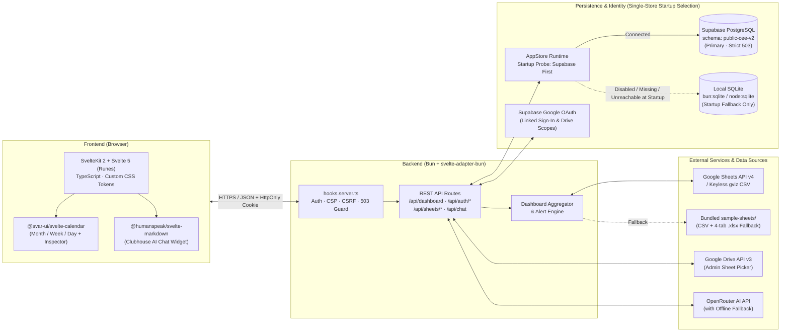

# Academic AC — Club Activity Dashboard

Web dashboard for a student club committee built with **Bun + SvelteKit 2 (Svelte 5) + Supabase (`public-cee-v2`) / SQLite fallback + `@svar-ui/svelte-calendar` + Google Sheets / Drive + OpenRouter AI**. Reads a connected Google Sheet (or the built-in normalized `sample-sheets/` mock dataset) and provides executive summary analytics, an interactive multi-day SVAR Calendar, project/member/budget views, automatic budget and schedule alerts, Supabase-first persistence with local SQLite fallback, linked Google OAuth sign-in, Light/Dark themes, and a Markdown-rendered AI assistant.

> All bundled data in this repository is **mock data** (`6600000001`–`6600000067` for club members, `6600000068`–`6600000732` for external event attendees, `AC-001`–`AC-020` for events) with fictional names. Do not put real personal data, student IDs, phone numbers, or private photos into public sheets.


## Features

> For a detailed breakdown of every feature—what it is, relevant source files, and how it works internally—see [**Feature Documentation (`docs/FEATURES.md`)**](./docs/FEATURES.md).

| Area | What it does |
|---|---|
| **Summary** | Executive KPI cards (members, active retention, events, planned vs. actual budget), interactive attendance & budget charts with legend toggles, top expense categories, upcoming events, active projects, and CSV report export. |
| **Events calendar** | Powered by **`@svar-ui/svelte-calendar`** (`Willow` / `WillowDark`) with **Month, Week, and Day** views, continuous multi-day (`ต่อเนื่อง`) horizontal spanning bars, deterministic 8-color per-project palette (`EVENT_PALETTE`), filter pills (`All`, `Multi-day ต่อเนื่อง`, `In Progress`, `Completed`, `Cancelled`), contained Month/Event jump dropdowns, viewport-clamped hover tooltips, and a synchronized **Selected Event & Date Inspector** with direct `Inspect Project →` navigation. |
| **Project data** | Relevance search (Thai + English, typo-tolerant), status & category filters, sorting (`Best match`, `Newest`, `Oldest`, `A–Z`), and full project detail pages showing venue, Thai/English status (`ดำเนินการ` / `ปิดโครงการ` / `ยกเลิก`), multi-day schedule, staff vs. participant counts, **Attendance breakdown** (`Gender / Year / Major`), and **Budget** utilization. |
| **Members & Budget** | Dedicated **Members** directory (search, status/department filters, year & major demographics) and **Budget** ledger view (income vs. expense KPIs, category breakdown, project budget health bars, and searchable transaction table). |
| **Accounts & Auth** | Streamlined 2-mode 10-digit Student ID authentication (**Sign in** & **Sign up**) with automatic database lookup (shows pre-seeded/existing member name without re-entry), uppercase/lowercase/digit password validation, and server-enforced roles: **Admin** (`6600000001`) and **Member** (`6600000002`–`6600000067`). Supports **linked-only Google Sign-In** via Supabase OAuth (unlinked Google emails cannot auto-register). Admins access **Users**, **Data source**, **Sync data now**, and **Link Google account** from the top-right account menu (`#userMenu`); normal users see identity, data status, and **Sign out**. |
| **Google Sheets & Drive Sync** | **Admin-only** interactive Sheet Picker modal (`SheetPickerModal`): browse spreadsheets directly from Google Drive via Supabase Google OAuth (`drive.readonly` + `spreadsheets.readonly` with Drive API `403 SERVICE_DISABLED` activation diagnostics), paste any public Google Sheet URL (keyless `gviz/tq` CSV mode or API v4 `values:batchGet`), switch back to Mock Data, or download the 4-tab `Clubhouse-Google-Sheet-Ready.xlsx` workbook / individual CSV templates (`/api/sheets/export-csv`). Cached for 30 s with stale-on-error fallback. |
| **AI Chatbox** | Bottom-right **Clubhouse Assistant** powered by **OpenRouter AI** (supports reasoning models such as `z-ai/glm-5.3-flash` with `2048` default `max_tokens` and `reasoning` fallback), renders rich Markdown via `@humanspeak/svelte-markdown`, uses privacy-safe club/project/category aggregates (never member emails/phones), and falls back to an offline Thai & English answerer when no API key is configured. |
| **Theme & Alerts** | 1-button Light/Dark toggle (`#themeToggle`) persisted per account in the active database (`PATCH /api/me/theme`) with zero-flash SSR `data-theme` injection. Automatic bell + toast alerts for budget spending **&ge; 80%** (warning) / **&ge; 100%** (critical) and `Scheduled` events starting within **3 days**. |
| **Responsive UI** | Sticky **Academic AC** topbar shell (no sidebar) with a **Summary** dropdown (`Summary`, `Members`, `Budget`, `Events calendar`) and **Project data** tab on desktop and vertical/portrait monitors (`> 760px`), responsive grid stacking at `<= 1120px` / `max-aspect-ratio: 4/5`, and a fixed 5-tab SVG-icon mobile bottom bar (`Summary`, `Projects`, `Calendar`, `Members`, `Budget`) at `<= 760px`. |

## Tech Stack

- **Runtime & Storage:** Bun + **Supabase PostgreSQL** (`schema: public-cee-v2`) as the primary store when available at startup (**strict `503` on mid-request failure**), with automatic startup fallback to **Local SQLite** (`bun:sqlite` / `node:sqlite`) when offline or unconfigured
- **Framework:** SvelteKit 2 + Svelte 5 (runes) + TypeScript + `svelte-adapter-bun`
- **UI & Calendar:** `@svar-ui/svelte-calendar`, `@humanspeak/svelte-markdown`, custom CSS design tokens
- **Integrations:** Google Sheets API v4 / keyless `gviz` CSV, Google Drive API v3, Supabase Google OAuth, OpenRouter Chat Completions API
- **Deployment & Testing:** Docker (`oven/bun:1-alpine`), Render Blueprint (`render.yaml`), `bun test`, `tsc --noEmit`

### Architecture & Tech Stack Diagram



## Run Locally

```bash
cp .env.example .env     # optional: works out of the box with sample-sheets/ mock data & local SQLite
bun install              # install dependencies
bun run dev              # start Vite + SvelteKit dev server (http://localhost:5173)
```

Production build & run:

```bash
bun run build            # build standalone Bun server into ./build
bun start                # run production server (bun ./build/index.js)
```

Tests, typecheck & mock sheet generation:

```bash
bun test                 # run unit & API integration tests (37 tests)
bun run check            # run svelte-kit sync && tsc --noEmit
python3 scripts/build-mock-sheets.py   # regenerate sample-sheets/*.csv & Clubhouse-Google-Sheet-Ready.xlsx
```

Default mock accounts (seeded idempotently from `Members` on startup into Supabase `public-cee-v2` when connected, or `data/app.db` in local fallback mode):
- **`6600000001`** — **Admin** (`Sutthikan Panla`)
- **`6600000002` – `6600000067`** — **Members**
- Open the app, click **Sign up**, enter your 10-digit student ID (pre-seeded accounts automatically show your registered name), and set a password (8+ chars with uppercase, lowercase, and a number).

## Connect Google Sheets & Supabase

### 1. Google Sheets
1. Upload [`sample-sheets/Clubhouse-Google-Sheet-Ready.xlsx`](./sample-sheets/Clubhouse-Google-Sheet-Ready.xlsx) to Google Drive and open it as a Google Sheet (or import the 4 CSV files in `sample-sheets/` into tabs named `Members`, `Events`, `Attendance`, and `Budget`).
2. Share the sheet as **Anyone with the link &rarr; Viewer** (or keep it private and sign in as Admin with Google OAuth Drive/Sheets scopes).
3. As an **Admin** (`6600000001`), open **Sync sheet / Connect Sheet** in the dashboard to either pick the file from Google Drive or paste the Google Sheet URL directly — or configure `GOOGLE_SHEET_ID` (and optional `GOOGLE_API_KEY`) in `.env`.

| Tab | Columns (header row, any order; extra columns are ignored) |
|---|---|
| `Members` | `member_id`, `full_name`, `department`, `role`, `email`, `joined_date`, `gender`, `year`, `major`, `member_status` |
| `Events` | `event_id`, `title`, `date`, `end_date`, `location`, `description`, `budget_planned`, `status`, `image_url` |
| `Attendance` | `attendance_id`, `event_id`, `member_id`, `full_name`, `check_in_time`, `status`, `participant_type`, `project_role`, `gender`, `year`, `major` |
| `Budget` | `expense_id`, `event_id`, `type` (`Income`/`Expense`), `category`, `amount`, `date`, `receipt_ref` |

### 2. Supabase Primary Persistence & Google OAuth (Optional)
1. Run [`supabase/schema.sql`](./supabase/schema.sql) in the Supabase SQL Editor to create the `public-cee-v2` schema (`users`, `sessions`, `app_settings`).
2. In Supabase **Settings &rarr; API &rarr; Exposed schemas**, add `public-cee-v2`.
3. Set `SUPABASE_URL`, `SUPABASE_PUBLISHABLE_KEY`, `SUPABASE_SECRET_KEY`, and `SUPABASE_SCHEMA=public-cee-v2` in `.env`.
   - When reachable at startup, all user accounts, sessions, and `app_settings` read/write exclusively against Supabase (local SQLite is not opened), and mid-request Supabase failures return HTTP **`503`** cleanly instead of failing over to SQLite.
   - If Supabase is disabled, schema-missing (`PGRST106`), or unreachable at startup, the server falls back cleanly to local SQLite (`data/app.db`).
4. To enable **Google Sign-In** (linked accounts) and **Google Drive Sheet Picker**, enable the Google provider in Supabase Auth and whitelist `<your-origin>/auth/callback` under **Authentication &rarr; URL Configuration &rarr; Redirect URLs**.

## Deployment

### Render (Free Docker Web Service)
This repository includes a production [`Dockerfile`](./Dockerfile) and [`render.yaml`](./render.yaml) Blueprint:

1. Push the repository to GitHub.
2. In [Render Dashboard](https://dashboard.render.com), choose **New + &rarr; Blueprint** (or **Web Service &rarr; Docker**) and select the repo.
3. Configure environment variables (`SUPABASE_URL`, `SUPABASE_PUBLISHABLE_KEY`, `SUPABASE_SECRET_KEY`, `SUPABASE_SCHEMA=public-cee-v2`, `OPENROUTER_API_KEY`, `OPENROUTER_MODEL`, `PROTOCOL_HEADER=x-forwarded-proto`, `HOST_HEADER=x-forwarded-host`, `TZ_NAME=Asia/Bangkok`).
4. Set Health Check Path to `/api/health`.
5. Whitelist `https://<your-render-domain>/auth/callback` in Supabase Auth Redirect URLs.

> Because Render's container filesystem is ephemeral, configuring `SUPABASE_URL` + `SUPABASE_SECRET_KEY` keeps all user accounts, passwords, sessions, theme preferences, Google account links, and sheet settings exclusively in **Supabase (`public-cee-v2`)**.

### Local Docker Compose
```bash
# Build and run in Docker on http://localhost:3000
docker compose up -d --build
```

## Security Notes

- Passwords use `node:crypto` `scrypt` with per-user 16-byte random salts. Sessions use 32-byte random tokens stored as SHA-256 hashes in `HttpOnly` + `SameSite=Lax` cookies (`Secure` automatically enabled behind HTTPS / `x-forwarded-proto: https`).
- Login, password setup, registration, and chat endpoints are rate-limited; write endpoints enforce `application/json` and same-origin validation; strict CSP (`mode: 'auto'`) and security headers are applied in [`src/hooks.server.ts`](./src/hooks.server.ts) and [`svelte.config.js`](./svelte.config.js).
- If Supabase is selected at startup and encounters a mid-request outage, [`src/hooks.server.ts`](./src/hooks.server.ts) returns HTTP `503` (`StoreUnavailableError`) with security headers instead of silently failing over to local SQLite.
- Google Sign-In only authenticates pre-linked accounts; Google Sheet configuration and Drive browsing require `role === 'admin'`.
- The AI chatbox sends only aggregate club/event statistics — never member emails or phone numbers.

## Architecture Decision Records

See [`docs/adr/README.md`](./docs/adr/README.md) for all architecture decision records:

- [ADR-0001: Mock Data Normalization into 4 Canonical CSV Tabs](./docs/adr/0001-mock-data-normalization.md)
- [ADR-0002: Bun + SvelteKit (Svelte 5) Full-Stack Architecture](./docs/adr/0002-bun-sveltekit-architecture.md)
- [ADR-0003: OpenRouter AI Chatbox Integration & Enriched Club Context](./docs/adr/0003-openrouter-ai-chat.md)
- [ADR-0004: Google Calendar-Style Week & Month Views with Project Navigation](./docs/adr/0004-calendar-week-and-month-views.md)
- [ADR-0005: Club Dashboard Rebranding & DB-Persisted Theme Preference](./docs/adr/0005-branding-and-db-theme-preference.md)
- [ADR-0006: Idempotent Member Seeding, Admin Promotion & Node/Bun Compatibility](./docs/adr/0006-idempotent-admin-seeding.md)
- [ADR-0007: Clubhouse UI/UX Redesign with Real Mock-Data Views](./docs/adr/0007-clubhouse-ui-redesign.md)
- [ADR-0008: Svelte-Markdown Chat, 1-Button Theme Toggle, Calendar UX Overhaul, Supabase (`public-cee-v2`), & Google Drive Sheet Selector](./docs/adr/0008-markdown-calendar-supabase-drive-sheets.md)
- [ADR-0009: Supabase Google OAuth for Sign-In & 1-Click Google Drive Sheet Picker](./docs/adr/0009-supabase-google-oauth-drive-integration.md)
- [ADR-0010: Linked-Only Google Sign-In, Admin-Only Sheet Selection, & Drive API 403 Diagnostics](./docs/adr/0010-google-account-linking-and-admin-sheet-guard.md)
- [ADR-0011: SVAR Svelte Calendar Integration & Mobile / Vertical Display Responsive Layout](./docs/adr/0011-svar-calendar-and-responsive-layout.md)
- [ADR-0012: Supabase Primary Store with Strict 503 & Local SQLite Startup Fallback](./docs/adr/0012-supabase-primary-strict-sqlite-fallback.md)

## Project Layout

```text
Dockerfile                 Multi-stage oven/bun:1-alpine production image
docker-compose.yml         Local Docker Compose configuration
render.yaml                Render Blueprint (Free Docker Web Service)
supabase/
  schema.sql               PostgreSQL schema for public-cee-v2 persistence
src/
  app.html                 HTML shell + CSP-nonced zero-flash theme script
  app.css                  Clubhouse Light & Dark tokens, SVAR Calendar theme, responsive layout
  hooks.server.ts          Auth session, CSRF/JSON guards, 503 error guard, SSR theme injection
  lib/
    calendar.ts            SVAR event mapping, 8-color EVENT_PALETTE, Month/Week/Day helpers
    search.ts              Project-name relevance search (Thai + English, typo-tolerant)
    format.ts              Currency, date range, percentage, and API fetch helpers
    validation.ts          10-digit student ID & password complexity validators
    types.ts               Shared TypeScript domain interfaces
    components/            AuthView, Topbar, SummaryView, Calendar, CalendarTooltip,
                           BarChart, ProjectsView, MembersView, BudgetView, UsersView,
                           SheetPickerModal, ChatWidget, ToastContainer
    server/                store.ts, auth-crypto.ts, supabase.ts, db.ts, runtime.ts,
                           sheets.ts, mock.ts, dashboard.ts, alerts.ts, chat.ts, dates.ts, http.ts
  routes/
    +layout.server.ts      SSR session & theme loader
    +layout.svelte         Theme context & localStorage sync
    +page.svelte           Root app shell & view router
    auth/callback/         Supabase Google OAuth callback handler
    api/                   REST endpoints (/health, /me, /me/theme, /dashboard, /chat,
                           /auth/{login,logout,register,setup,google},
                           /sheets/{config,drive,export-csv}, /admin/users/*)
docs/
  FEATURES.md              Detailed documentation of every feature and how it works
  adr/                     Architecture Decision Records (0001–0012)
  images/                  Dashboard preview screenshots
sample-sheets/             Members.csv, Events.csv, Attendance.csv, Budget.csv,
                           Clubhouse-Google-Sheet-Ready.xlsx
scripts/                   build-mock-sheets.py, export-sample-sheets.js
tests/                     Bun unit & API integration test suite (tests/app.test.ts)
```

License: MIT
